# drawing2cad

Convert uploaded technical PDFs into an editable part description, a dimensioned DXF drawing with a PDF copy, and validated STEP through one MCP interface.
The Docker image includes PDF tools, build123d, OCP/OpenCascade, STEPcode, the drawing adapter, and isolated workers.
The skill uses domain tools and remains independent of the CAD backend.

## Docker start

From the repository root:

```bash
docker compose -f compose.mcp.yaml build
docker compose -f compose.mcp.yaml run --rm -T mcp
```

The second command starts an MCP stdio process.
Connect an MCP client to its stdin/stdout; it is not a browser endpoint.
The container has no network.
Send PDF bytes through the upload tools. Clients use source, run, job, and artifact IDs.
No source-directory mount or client access to server paths is required.
The named `cad-data` volume preserves uploaded sources, revisions, jobs, notes, and immutable artifacts under `/data`.

For Streamable HTTP, supply `DRAWING2CAD_HTTP_TOKEN` through your secret mechanism, then run:

```bash
docker compose -f compose.mcp.yaml -f compose.mcp-http.yaml up --build -d
```

Connect to `http://127.0.0.1:8765/mcp` with the same bearer token.
The HTTP profile exposes only the host loopback interface. It does not include the web interface.

Call `drawing2cad_status`, `cad_capabilities`, and `cad_worker_probe` before CAD work.
The worker requires the supported Linux sandbox.
A host without that sandbox cannot silently execute CAD without isolation.
See the [MCP guide](drawing2cad-mcp/README.md) for tools, configuration, and tests.

## Delivery milestones

| Milestone | Deliverables and limits |
|---|---|
| M1 metric prototype | Editable JSON part description, validated STEP candidate, review list, coverage report, manifest, and trace. |
| M2 MCP, [#24](https://github.com/hackhog/drawing2cad/issues/24) | Shared Python services, PDF uploads, source/artifact IDs, persistent jobs and notes, and dimensioned DXF/PDF drawing delivery. |
| M2 Web, [#26](https://github.com/hackhog/drawing2cad/issues/26) | HTTP API and React/shadcn/TanStack interface in the same Python application, using the shared services. Pending. |
| M3 AP242 | STEP-only construction reconstruction, driving parameter edits through adapters, semantic PMI, and graphical PMI. |

The web interface and complete M3 acceptance remain required follow-up work.
The initial [AP242 adapter](docs/adr/0017-ap242-application-construction-and-pmi.md)
adds application-specific construction replay and nominal PMI. AP242 builds require
bounded independent STEPcode analysis. Headless PDF/PNG inspection shows the actual
stored PMI strokes, with annotation-plane detail views. Full conformance and the
remaining PMI scope stay open in #25. Product input is PDF; external STEP
upload is out of scope. Internal re-import tests verify generated STEP output.
CAD-specific export and native feature adapters are separate in
[#33](https://github.com/hackhog/drawing2cad/issues/33).
The JSON description is the editable source for the declarative M1 path.
A free-code fallback also requires its exact recorded inline payload. JSON alone does not replay that construction.
It does not prove editable construction or semantic PMI inside STEP.
The technical drawing and 3D model can be created in either order.
Their final revisions must agree.

[ADR 0014](docs/adr/0014-headless-build123d-metric-prototype.md) defines the backend decision, sandbox boundary, evaluation set, and acceptance criteria.
A server-side geometry pass is separate from independent STEP analysis and an NX opening test.
Missing tests remain `not_tested`.
[ADR 0016](docs/adr/0016-shared-domain-service-and-drawing-delivery.md) defines the M2 service boundary and drawing limits.
The drawing adapter renders supplied 2D view geometry with native DXF dimensions. It does not derive arbitrary projections or sections from a solid.
Independent source review is still required. Resource acceptance trials remain deferred until the milestones are complete; #12 is closed.

## Architecture

<picture>
  <source media="(prefers-color-scheme: dark)" srcset="docs/diagrams/drawing2cad-overview.dark.svg">
  
</picture>

[Open the generated browser diagram](docs/diagrams/drawing2cad-overview.html) locally for theme, zoom, and SVG downloads.
Its source is [drawing2cad-overview.json](docs/diagrams/drawing2cad-overview.json).
After a source change, run `npm run build --prefix tools/diagrams`.
CI verifies exact generated output with `npm run check --prefix tools/diagrams`.
The renderer is part of the repository; it needs no machine-local archify installation.

## Existing demo

```bash
docker compose up --build
```

Open `http://localhost:8000`.
The existing demo has separate frontend and backend containers.
It supports temporary PDF analysis and uploaded STEP display.
It does not implement the M2 persistent upload, artifact, or unified application contract.
See [app/README.md](app/README.md).

## Project structure

| Path | Contents |
|---|---|
| [drawing2cad-mcp/](drawing2cad-mcp/README.md) | Python MCP, PDF tools, part service, worker, and tests. |
| [compose.mcp.yaml](compose.mcp.yaml) | Headless Docker service with uploads and stdio transport. |
| [compose.mcp-http.yaml](compose.mcp-http.yaml) | Authenticated Streamable HTTP override on host port 8765. |
| [Streamable HTTP guide](drawing2cad-mcp/STREAMABLE_HTTP.md) | HTTP transport, authentication, LiteLLM, and deployment limits. |
| [skills/drawing2cad/](skills/drawing2cad/SKILL.md) | Reusable skill and focused references. |
| [app/](app/README.md) | Existing development demo. |
| [docs/adr/](docs/adr/README.md) | Architecture decisions and staged acceptance scope. |
| [docs/diagrams/](docs/diagrams/drawing2cad-overview.json) | Versioned diagram source and generated HTML/SVG. |
| `tools/diagrams/` | Portable diagram generator and parity tests. |
| [litellm-mcp.example.json](drawing2cad-mcp/litellm-mcp.example.json) | Streamable HTTP registration example. |
| [litellm-stdio.example.json](drawing2cad-mcp/litellm-stdio.example.json) | Optional stdio registration example. |
| `resources/` | Original drawings and CAD references; construction roles are assigned per run. |
| `output/` | Ignored generated models, drawings, previews, traces, and reports. |

## Agent workflow

Load the complete [drawing2cad skill](skills/drawing2cad/SKILL.md) in the client.
MCP registration supplies tools; it does not install the skill.
Use the live catalog and capability results before construction.

Upload the authorized PDF, inspect its images, record dimensions and assumptions, build through the MCP, and validate measured geometry.
Create the technical drawing, inspect its PDF, and record a review of its exact revision and source hashes.
Either drawing or model can be created first. STEP release requires their current revisions to agree.
Export a temporary STEP candidate and re-import it in a fresh worker.
Keep original resources unchanged.
Do not use a verification STEP as an unreported construction input.

Jobs use idempotency keys. Inspect job and run state after a lost response.
Cancellation cannot undo a running operation. An interrupted job is not replayed automatically.
The MCP uses one configured principal. The service contracts permit a future authenticated web adapter; they do not provide web authentication or hostile multi-tenant isolation.

The current MCP executes CAD only through the headless build123d worker.
The FreeCAD proxy has been removed. Historical adapter references remain for provenance; their calls are unavailable through the current MCP.

## Documentation and version control

Use technical English in accordance with ASD-STE100 for project documentation, comments, docstrings, and tool descriptions.
Use the [language guide](skills/drawing2cad/references/documentation-language.md).
Do not claim full conformity without the required review.

Keep source code, tests, dependency files, example configurations, maintained references, and original resources in Git.
Put generated artifacts in ignored output directories.
Do not commit environments, caches, credentials, or machine-specific configuration.
`.gitattributes` preserves original resource and STEP bytes for stable source hashes.
